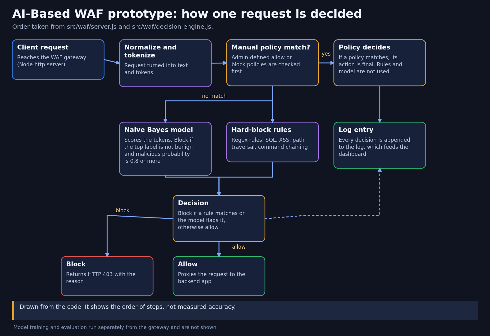

# AI-Based Web Application Firewall

This repository contains a self-contained prototype for a graduation project titled `AI-Based Web Application Firewall`.

The prototype combines:

- a sample backend web application,
- a lightweight machine-learning classifier,
- a hybrid decision engine that uses both ML and explicit security rules,
- a reverse-proxy WAF gateway that blocks suspicious HTTP requests,
- a dashboard for logs, metrics, and generated evaluation artifacts,
- a benchmark script that produces report-ready runtime results.

## Request flow

How the gateway in `src/waf/server.js` and `src/waf/decision-engine.js` decides one request. The diagram shows the order of steps, not measured accuracy.



## Project structure

- `data/training-samples.json`: labeled benign and malicious HTTP request samples
- `src/ml/`: feature extraction, model training, and evaluation
- `src/backend/`: protected demo application
- `src/waf/`: reverse-proxy WAF gateway and decision logic
- `src/demo/`: demo runner that starts both servers and sends sample traffic
- `public/dashboard/`: interactive browser dashboard
- `models/`: generated trained model artifact
- `results/`: generated evaluation summary
- `logs/`: runtime WAF decision logs
- `final-report-finalized.md`: stronger report draft tied to the implemented system and measured results
- `dist/AI-Based Web Application Firewall - Final Report.docx`: submission-friendly Word report
- `presentation-speaking-notes.md`: oral presentation speaking notes
- `live-demo-script.md`: live demo walkthrough
- `references-ieee.md`: IEEE-formatted reference list ready to paste
- `cover-page-template.md`: cover page placeholders and required fields

## Prototype design

The WAF uses a multiclass Naive Bayes classifier trained on representative traffic classes:

- `benign`
- `sql_injection`
- `xss`
- `path_traversal`
- `command_injection`

The ML prediction is combined with a small set of explicit hard-block rules for obvious high-risk payloads. This keeps the project academically meaningful while still reflecting practical WAF design.

## How to run

### 1. Train the model

```powershell
node src/ml/train-model.js
```

### 2. Evaluate the model

```powershell
node src/ml/evaluate-model.js
```

### 3. Start the demo backend

```powershell
node src/backend/server.js
```

### 4. Start the WAF gateway

```powershell
node src/waf/server.js
```

### 5. Run the full demo automatically

```powershell
node src/demo/run-demo.js
```

### 6. Run the runtime benchmark

```powershell
node src/demo/run-benchmark.js
```

## Default ports

- Backend app: `http://localhost:4000`
- WAF gateway: `http://localhost:3000`

## WAF endpoints

- `GET /waf/status`: returns model and service status
- `GET /waf/metrics`: returns aggregated runtime metrics
- `GET /waf/events`: returns recent WAF log events
- `GET /waf/evaluation`: returns the latest offline evaluation result
- `GET /waf/benchmark`: returns the latest runtime benchmark result
- `GET /dashboard`: opens the interactive dashboard
- `POST /waf/classify`: classifies a request payload without forwarding it
- Any other path: inspected by the WAF and forwarded to the backend if allowed

## Dashboard features

- live service status
- blocked and allowed traffic counts
- label distribution
- recent decision log table
- offline evaluation summary
- runtime benchmark summary
- interactive request lab for synthetic payload classification

## Example requests

Benign request:

```powershell
Invoke-WebRequest -Uri "http://localhost:3000/products?category=laptops&sort=price"
```

SQL injection attempt:

```powershell
Invoke-WebRequest -Uri "http://localhost:3000/login?username=admin'%20OR%201%3D1--&password=x"
```

XSS attempt:

```powershell
Invoke-WebRequest -Uri "http://localhost:3000/search?q=%3Cscript%3Ealert(1)%3C%2Fscript%3E"
```

## Academic notes

- This is a prototype, not a production-grade WAF.
- The dataset is controlled and intentionally small for demonstration.
- Evaluation results should be presented honestly as prototype results.
- The system is designed to be explainable in a viva or final report.
- The architecture diagram is available in `architecture-diagram.mmd`.
- API details are summarized in `api-reference.md`.
